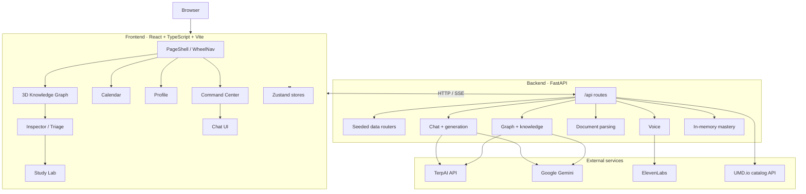

# Zenith Architecture

## 1. System context

Zenith is currently a browser-based academic-workspace prototype. The frontend is a React single-page application. It communicates with a FastAPI backend over HTTP; chat responses are streamed using Server-Sent Events (SSE).

The backend is an integration layer around seeded academic data and external services. It is not backed by a database, and it does not currently authenticate individual students.

## 2. High-level component diagram

## 3. Frontend structure

### Application shell

- `src/main.tsx` mounts the React application and its router provider.
- `src/App.tsx` calls `useMockData()`, renders `PageShell`, and conditionally renders the separate Chat modal when the Zustand `chatModalOpen` flag is true.
- `components/layout/PageShell.tsx` is the active view shell. It uses local view state from Zustand and renders the Command Center, Neural Lattice home view, Calendar, and Profile.
- `components/layout/WheelNav.tsx` changes the active shell view through a callback. The active shell navigation is not a conventional URL-driven route table.
- `components/layout/CommandDock.tsx` exposes graph filters, graph modes, camera reset, and navigation to the Command Center.

### State management

Two Zustand stores divide application state:

- `store/useAppStore.ts`: seeded domain data, chat messages, study artifacts, graph filters, selected course/concept, UI flags, and client-side mastery history.
- `store/useCommandStore.ts`: triage statuses, system-status labels, and the active remediation plan.

The stores are in-memory. There is no persistence middleware or database synchronization in the current implementation.

### Graph pipeline

1. `useMockData` fetches concepts, connections, courses, assignments, announcements, and syllabi.
2. `useGraphFilters` filters concepts by selected course, mastery range, and view mode.
3. `useGraphData` calculates 2D positions with `lib/graph-layout.ts` and maps domain data into graph node/link shapes.
4. `KnowledgeGraph` renders the data with `react-force-graph-3d` and Three.js.
5. Selecting a concept opens the inspector, which can request generated study artifacts or ask the backend to build topic context.

The separate `SkillTree` component is an SVG-based alternative; the active shell's graph view uses `KnowledgeGraph`.

## 4. Backend structure

`backend/main.py` creates the FastAPI application, configures CORS and lifecycle handling, registers routers under `/api`, and exposes `/api/health`.

| Module | Responsibility |
|---|---|
| `routers/data.py` | Read-only access to seeded courses, assignments, notes, concepts, connections, syllabi, and announcements |
| `routers/chat.py` | Streaming chat response; TerpAI primary path and Gemini fallback |
| `routers/generate.py` | Flashcard, quiz, and study-guide generation |
| `routers/parse.py` | Upload and extract text from supported documents |
| `routers/graph.py` | Initial graph response and concept/relationship extraction |
| `routers/knowledge.py` | Build topic context, refresh graph context, recommend courses |
| `routers/umd.py` | Proxy selected UMD.io catalog endpoints |
| `routers/voice.py` | Text-to-speech and speech transcription |
| `routers/mastery.py` | In-memory mastery update and lookup |

Pydantic request/response models live in `backend/models/schemas.py`; seeded-data models live in `backend/models/data_models.py`.

## 5. AI and integration flows

### Chat

1. The frontend sends the message history and optional dashboard context to `POST /api/chat`.
2. The backend builds a prompt using the current seeded academic data and supplied dashboard context.
3. The TerpAI bridge sends the prompt to the configured TerpAI API and reads its streamed response.
4. If TerpAI is unavailable, the backend attempts the Gemini fallback.
5. The backend streams content chunks to the browser as SSE.

The frontend currently parses SSE `data:` messages for a `content` field. Error-only SSE payloads are not surfaced as visible chat errors by the current client.

### Study artifacts

The frontend sends a course ID and topic to one of the `/api/generate/*` endpoints. The backend constructs a prompt, tries the configured AI path, validates/normalizes the result, and returns structured flashcards, quiz questions, or Markdown study-guide content.

### Knowledge context

The knowledge router collects relevant seeded concepts, assignments, notes, course information, and connections. Gemini generates a focused context document. The TerpAI bridge can then create or update an agent's knowledge context.

The current specialized-agent UI stores an agent URL, but the active chat bridge primarily uses the main configured agent and injects topic context into the prompt. It should not yet be described as isolated per-topic agent routing.

### Voice

The backend exposes ElevenLabs-backed speech endpoints. The frontend's active Command Center currently uses the TTS hook for the morning brief and read-aloud actions. The separate speech-recognition/chat hook exists, but its UI path is not connected to the active Command Center microphone control.

### UMD catalog

The UMD router proxies course, course-detail, section, department, and term requests to UMD.io. This is catalog data, not authenticated access to a student's Canvas account.

## 6. Data ownership and persistence

| Data | Current source | Persistence |
|---|---|---|
| Courses, assignments, notes, announcements | Python sample-data modules | Repository files |
| Concepts and graph connections | Python sample-data modules | Repository files |
| Syllabi | Python sample-data modules | Repository files |
| Chat messages | Frontend Zustand store | Memory only |
| Generated study artifacts | Frontend component/store state | Memory only |
| Mastery updates | Frontend store and backend in-memory map | Memory only |
| Profile details | Hard-coded frontend sample values | Source code |
| Course catalog lookups | UMD.io | External service |

## 7. Important boundaries

- No database, account system, authorization, or student-specific data isolation is present.
- The seeded data is demonstration content and should not be presented as live student records.
- The UI's system-status labels are seeded state, not a live health-monitoring dashboard.
- The frontend currently assumes a local backend URL.
- The TerpAI bridge currently configures its HTTP client with TLS verification disabled; production use must not proceed with that setting.
- Several components and modal paths are present in the source but are not connected to the active application shell.

## 8. Source-of-truth files

- App bootstrap: `frontend/src/main.tsx`, `frontend/src/App.tsx`
- Active shell: `frontend/src/components/layout/PageShell.tsx`
- Frontend state: `frontend/src/store/useAppStore.ts`, `frontend/src/store/useCommandStore.ts`
- API client: `frontend/src/lib/api.ts`
- Backend app: `backend/main.py`
- Backend contracts: `backend/models/schemas.py`, `backend/models/data_models.py`
- Integrations: `backend/services/`
